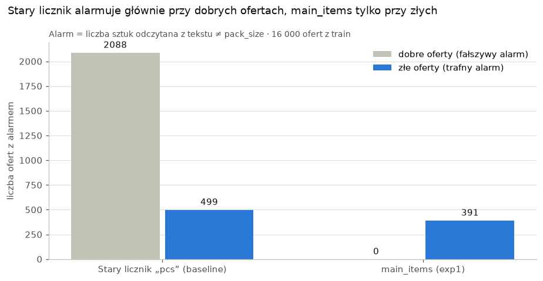
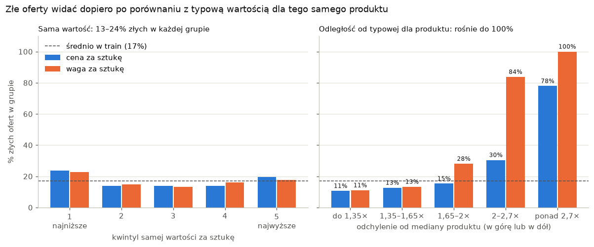
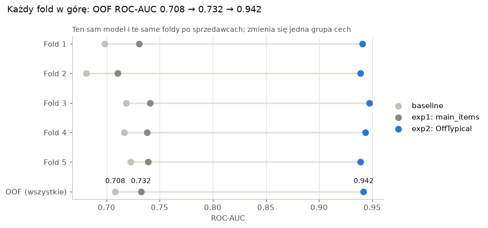

# DSC PJATK Catalogue Quality Challenge

Rozwiązanie zadania rekrutacyjnego Koła Data Science PJATK: dla każdej oferty e-commerce model podaje
prawdopodobieństwo, że zawiera kontrolowany błąd (kategoria, cena, waga albo liczba sztuk).
Metryka: ROC-AUC. Walidacja: 5 foldów rozłącznych po sprzedawcach (podział z baseline organizatorów).

## Wyniki (OOF na 16 000 ofert z train)

| Wersja | Zmiana względem poprzedniej | OOF ROC-AUC | AP | Foldy 1–5 | Czas |
|---|---|---|---|---|---|
| baseline | kod organizatorów | 0.7082 | 0.5706 | 0.6983 / 0.6810 / 0.7184 / 0.7167 / 0.7226 | 22 s |
| exp1 | `main_items`: liczba sztuk z tekstu bez gratisów, z liczbami słowami | 0.7324 | 0.6237 | 0.7306 / 0.7107 / 0.7408 / 0.7382 / 0.7393 | 24 s |
| exp2 | `OffTypical`: odległość ceny i wagi za sztukę od mediany produktu | 0.9419 | 0.8717 | 0.9407 / 0.9387 / 0.9474 / 0.9435 / 0.9390 | 22 s |

Każde porównanie jest kontrolowane: ten sam model (regresja logistyczna, C=2, liblinear, seed 42),
te same hiperparametry i te same foldy; zmienia się jedna grupa cech.

Wynik publiczny na Kaggle (exp2): 0.94576.

## Pliki

- `notebooks/dsc-catalogue-eda.ipynb` – eksploracja danych z dwoma wykresami i wnioskami, z których wynikły obie zmiany.
- `notebooks/dsc-catalogue-model.ipynb` – model (baseline + exp1 + exp2), walidacja, `submission.csv`,
  wykres skuteczności wersji oraz analiza 5 błędów OOF (reguła decyzji, macierz pomyłek, wybór przypadków).
- `raport.pdf` – raport (15 stron): dane, walidacja, oba porównania, analiza błędów, największe wyzwania, użycie AI.
- `figures/` – wykresy z notebooków jako pliki PNG.

Oba notebooki są zapisane razem z wynikami i wykresami, więc można je czytać bez uruchamiania.

## Najważniejsze wykresy

**1. Stary licznik sztuk alarmuje głównie przy dobrych ofertach, `main_items` tylko przy złych** (porównanie #1)

**2. Złe oferty widać dopiero po porównaniu z typową wartością dla tego samego produktu** (porównanie #2)

**3. Każdy fold rośnie przy obu zmianach**

## Jak uruchomić

Na Kaggle: zaimportuj notebook, dołącz dane konkursu (Add Input → competition data) i uruchom wszystkie komórki.
Lokalnie: umieść `train.csv`, `test.csv` i `sample_submission.csv` w `data/public/` i uruchom notebooki.
Wymagania: CPU, bez internetu, ok. 25 s. Wersje z przebiegu na Kaggle: Python 3.13, numpy 2.1.3,
pandas 2.3.3, scikit-learn 1.6.1; do wykresów matplotlib (`requirements.txt`). Seed 42; podział na foldy
to SHA-256(seed:seller_id) mod 5. Wyniki zapisane w notebookach pochodzą z przebiegu lokalnego (Python 3.12,
te same wersje bibliotek); OOF różni się od Kaggle dopiero na 6. miejscu po przecinku (0.941876 vs 0.941872).

Danych konkursu nie ma w repozytorium (regulamin zabrania ich redystrybucji).

## Najważniejsze decyzje

- **Bez przecieku.** `main_items` czyta tylko tekst i niczego się nie uczy. Mediany w `OffTypical`
  liczone są w `fit`, czyli tylko na foldzie treningowym; na foldzie walidacyjnym działa tylko `transform`.
  Target służył wyłącznie do sprawdzania hipotez w EDA.
- **Reguła decyzji w analizie błędów:** budżet przeglądu 17% (2721 ofert, próg p ≥ 0.2883), wyznaczony
  tylko z predykcji OOF na train. TN 12 706, FP 573, FN 573, TP 2 148.

## Użycie AI

Kod i wyjaśnienia powstały z pomocą asystenta AI (Claude, Anthropic): propozycje pomysłów, pisanie i tłumaczenie
kodu, sprawdzanie wyników. AI nie dostarczało etykiet, predykcji ani cech dla pojedynczych ofert.
Dopiero zaczynam naukę data science, więc ta pomoc była duża; każdą komórkę uruchomiłem sam na Kaggle,
porównałem wyniki i przeszedłem przez kod funkcja po funkcji. Szczegóły w raporcie (sekcja 10).
Kod bazowy: `baseline_solution.ipynb` organizatorów konkursu.
